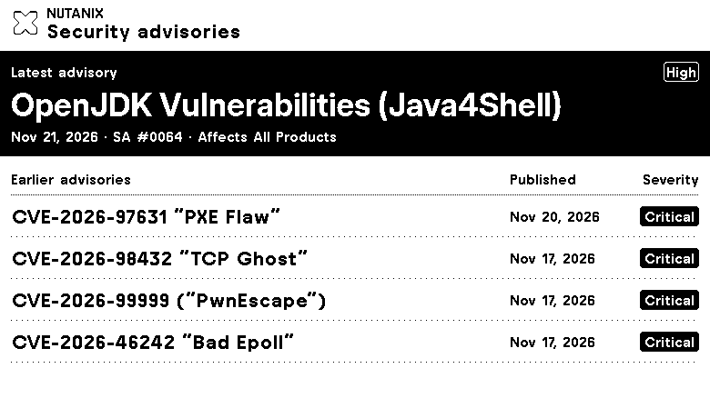

# Nutanix Security

Read Nutanix security advisories and released vulnerability fixes on TRMNL. The plugin uses public Nutanix data and works without an API key.

<a href="TRMNL/README.md#setup"></a>

[Set up on TRMNL](TRMNL/README.md#setup)



Captured from the Nutanix portal on November 21, 2026. [All layout previews](TRMNL/README.md#previews).

## Settings

| Setting | Options |
| --- | --- |
| Table to display | Security Advisories (default) or Vulnerability Fixes |
| Advisory order | Latest first (default) or Highest criticality first |
| Product (NXVD) | All products (default), AOS, AHV, Prism, Files, NDB, WitnessVM or Witness Service |

## Develop locally

Install [trmnlp](https://github.com/usetrmnl/trmnlp) and run:

```sh
cd TRMNL
trmnlp serve
```

Set the table, advisory order, and NXVD product for local previews in [TRMNL/.trmnlp.yml](TRMNL/.trmnlp.yml). Templates and settings live in [TRMNL/src/](TRMNL/src/). The [plugin guide](TRMNL/README.md) covers setup and checks.

## Sources

- [Nutanix Security Advisories](https://portal.nutanix.com/page/security/security-advisories/list)
- [Nutanix Vulnerability Database](https://portal.nutanix.com/page/security/security-vulnerabilities/list)
