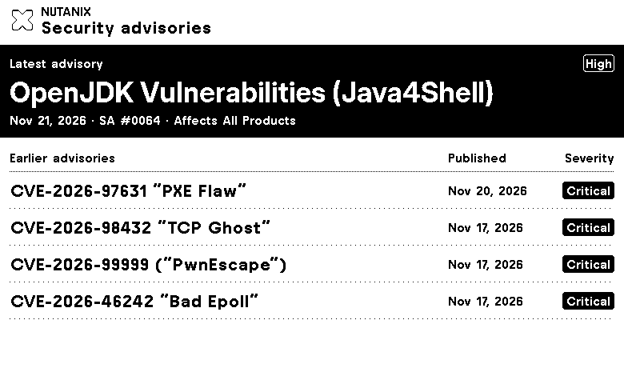
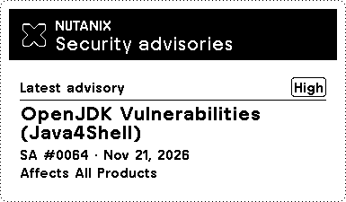
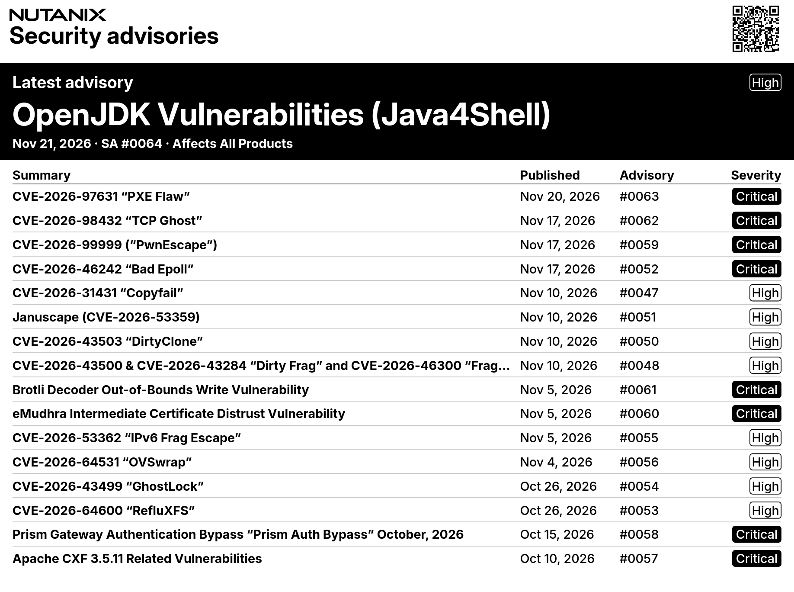
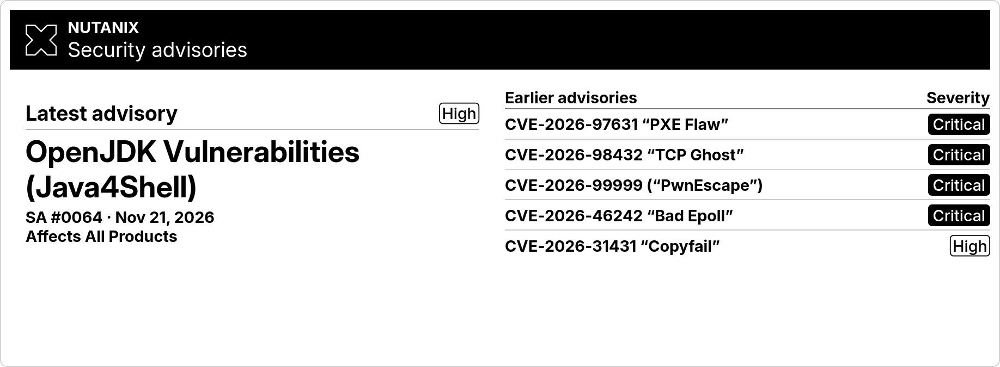
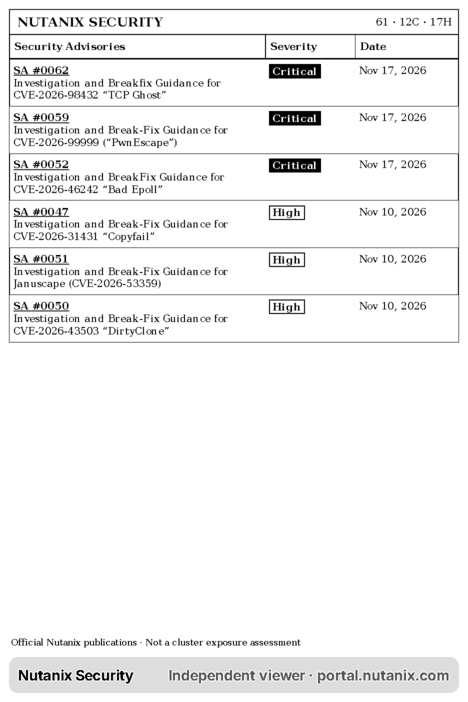
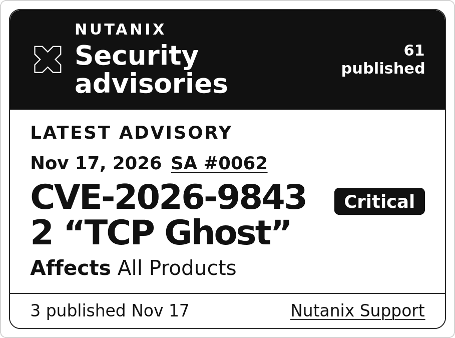
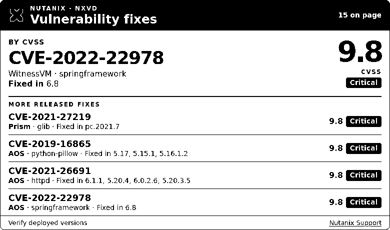
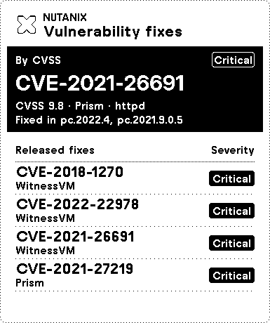
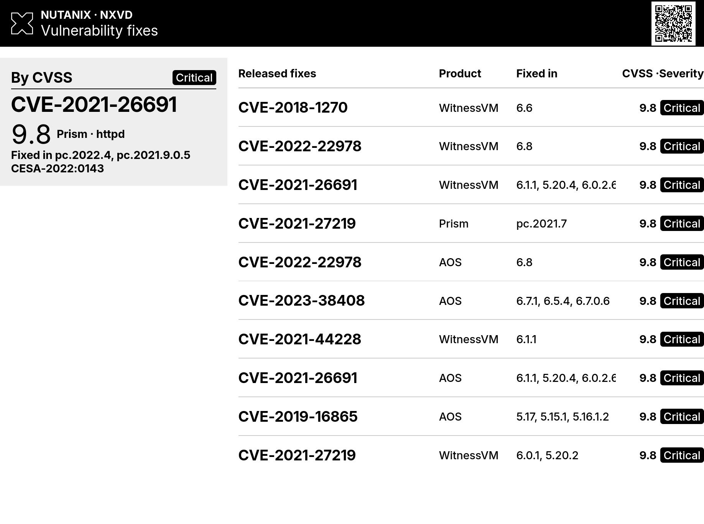

# Nutanix Security for TRMNL

## Setup

From the repository root, build the private plugin ZIP:

```sh
python3 scripts/package-import.py
```

On the [Private Plugins page](https://trmnl.com/plugin_settings?keyname=private_plugin), select **Import new** and upload `dist/trmnl-nutanix-sec-plugin.zip`. Choose **Table to display** in the plugin settings. Use **Advisory order** for Security Advisories or **Product (NXVD)** for the vulnerabilities table.

For manual setup, create a private plugin with Polling, an empty polling URL, Node Serverless and a 360-minute refresh interval. Copy the form fields from [settings.yml](src/settings.yml), paste [transform.js](src/transform.js) into Serverless, and copy the five Liquid files to their matching markup tabs.

## Icon

The listing icon is available at [media/icon.svg](media/icon.svg). Upload it separately from the private plugin ZIP.

## Previews

Recorded on November 21, 2026 using public Nutanix data.

| Security Advisories | Full | Half horizontal | Half vertical | Quadrant |
| --- | --- | --- | --- | --- |
| OG |  |  |  |  |
| X |  |  |  |  |

| NXVD | Full | Half horizontal | Half vertical | Quadrant |
| --- | --- | --- | --- | --- |
| OG |  |  |  |  |
| X |  |  |  |  |

## Templates

[Shared Liquid](src/shared.liquid) renders both briefs. Advisories leads with the latest publication by default. **Highest criticality first** ranks advisories by severity and shows newer publications first within each severity. NXVD leads with the first released fix on the CVSS-ranked page and shows its product, package and fixed release when available.

The full OG view stacks the lead and table. The full landscape X view uses a separate lead panel beside a wider table with dedicated publication dates or product and fixed-release columns. Portrait views stack the content. The OG quadrant shows one featured item, and the X quadrant also fits a short table. [TRMNL X layout guide](https://trmnl.com/framework/docs/3.4/trmnl_x_guide)

The templates cap the number of rows before rendering. Framework 3.4.6 handles typography, table sizing, and responsive visibility. Text clips in place as the browser lays out the page. The landscape limits below include the featured item.

| Layout | OG | X |
| --- | ---: | ---: |
| Full | 5 | 11 |
| Half horizontal | 4 | 6 |
| Half vertical | 5 | 10 |
| Quadrant | 1 | 3 |

## Data behavior

Each refresh makes one request to the selected Nutanix feed. The Advisories GET returns the whole catalog even with `limit` or `pageSize` set. NXVD requests the first 20 rows by descending CVSS, with a product filter when selected. Nutanix can return fewer rows than requested. Serverless sends up to 11 ranked items to TRMNL for the largest layout and keeps only fields used on screen. Check deployed versions separately to determine which fixes a cluster has.

The public NXVD response has no publication date field. In testing, `DATE`, `PUBLICATION_DATE` and `RELEASE_DATE` returned the same rows in the same order as an unknown sort column.

The portal endpoints are undocumented and may change. Empty responses and source errors have separate messages. To diagnose a refresh failure, enable **Debug Logs** in the private plugin settings.

## Checks

With Node.js 22, Python 3 and Docker installed, run from the repository root:

```sh
node --test TRMNL/tests/transform.test.cjs
./scripts/preview
docker run --rm --volume "$PWD/TRMNL:/plugin" trmnl/trmnlp:v0.32.3 lint
python3 scripts/package-import.py
```

The preview tests run the real transform against mocked Nutanix responses. They cover both briefs, empty data and an HTTP error in all four layouts on OG and X in landscape and portrait. Screenshots are written to `TRMNL/_build/previews/` and the HTML report is at `TRMNL/_build/report/index.html`.

## Publish

[Check plugin](../.github/workflows/check.yml) runs the tests, renders layouts, lints templates and builds the import ZIP. [Publish to TRMNL](../.github/workflows/publish.yml) runs these checks before publishing changes to `TRMNL/src/` on `main`. It can also be triggered manually.

Set the `TRMNL_API_KEY` and `TRMNL_PLUGIN_SETTING_ID` repository secrets to enable publishing. The setting ID is the integer in the private plugin's edit URL (`/plugin_settings/<ID>/edit`).
