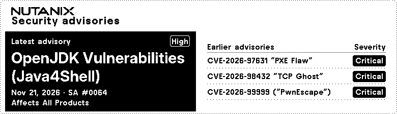
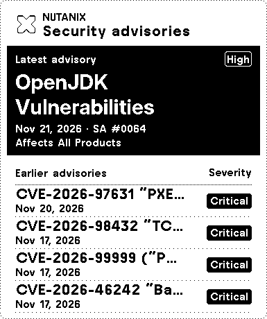
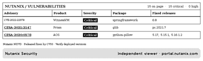
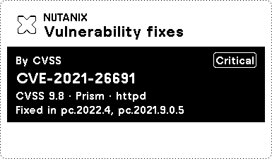
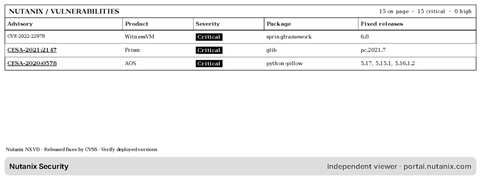
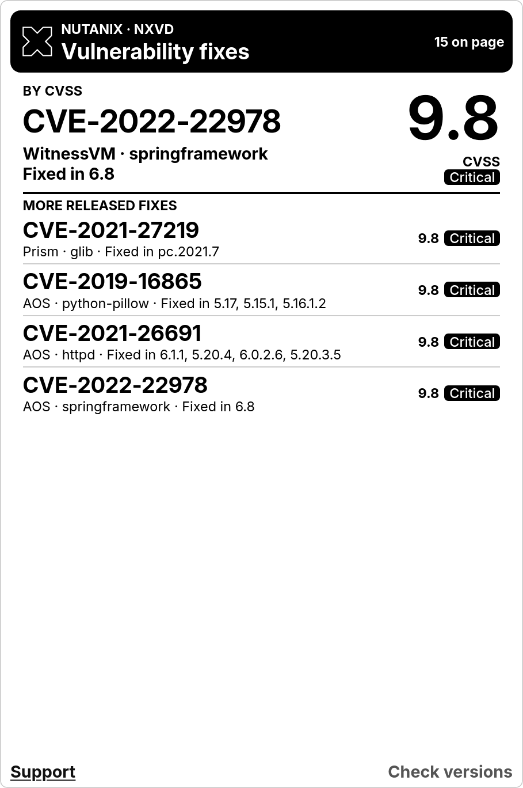
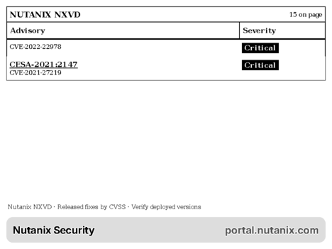

# Nutanix Security for TRMNL

## Setup

From the repository root, build the private plugin ZIP.

```sh
python3 scripts/package-import.py
```

The local build writes `dist/trmnl-nutanix-sec-plugin.zip`. Open Private Plugins, select **Import new**, and upload the ZIP. Use **Advisory order** for Security Advisories or **Product (NXVD)** for the vulnerabilities table. [Private Plugins](https://trmnl.com/plugin_settings?keyname=private_plugin)

For manual setup, create a private plugin with Polling, an empty polling URL, Node Serverless and a 360-minute refresh interval. Copy the form fields from [settings.yml](src/settings.yml), paste [transform.js](src/transform.js) into Serverless, and copy the five Liquid files to their matching markup tabs.

## Icon

The listing icon is available at [media/icon.svg](media/icon.svg). Upload it separately from the private plugin ZIP.

## Previews

Recorded on November 21, 2026 using public Nutanix data.

| Security Advisories | Full | Half horizontal | Half vertical | Quadrant |
| --- | --- | --- | --- | --- |
| OG |  |  |  |  |
| X |  |  |  |  |

| NXVD | Full | Half horizontal | Half vertical | Quadrant |
| --- | --- | --- | --- | --- |
| OG |  |  |  |  |
| X |  |  |  |  |

## Templates

[Shared Liquid](src/shared.liquid) renders both briefs. Advisories leads with the latest publication by default. **Highest criticality first** ranks advisories by severity and shows newer publications first within each severity. NXVD leads with the first released fix on the CVSS-ranked page and shows its product, package and fixed release when available.

The full view on both TRMNL OG and X has a small QR code in the header. It opens the selected table on Nutanix's support portal. NXVD opens with your selected product. The portal uses its own sort order.

The lead item sits in a dark panel above the table. Full landscape views give publication dates or products their own column, and X adds advisory numbers or fixed releases. The landscape horizontal split puts the lead beside the table. The OG quadrant shows one featured item, and the X quadrant also fits a short table. [TRMNL X layout guide](https://trmnl.com/framework/docs/3.4/trmnl_x_guide)

The templates cap the number of rows before rendering. Framework 3.4.6 handles typography, table sizing, and responsive visibility. Text clips in place as the browser lays out the page. The landscape limits below include the featured item.

| Layout | OG | X |
| --- | ---: | ---: |
| Full | 5 | 11 |
| Half horizontal | 4 | 6 |
| Half vertical | 5 | 10 |
| Quadrant | 1 | 3 |

## Data behavior

TRMNL's Polling strategy schedules refreshes. The Polling URL stays empty so Serverless can choose both the URL and HTTP method. TRMNL's Polling Verb setting applies one method to all configured URLs. [Dynamic Polling URLs](https://help.trmnl.com/en/articles/12689499-dynamic-polling-urls)

Each refresh makes one request to the selected Nutanix feed. The Advisories GET returns the whole catalog even with `limit` or `pageSize` set. NXVD requests the first 20 rows by descending CVSS, with a product filter when selected. Nutanix can return fewer rows than requested. Serverless sends up to 11 ranked items to TRMNL for the largest layout and keeps only fields used on screen. Check deployed versions separately to determine which fixes a cluster has.

The public NXVD response has no publication date field. In testing, `DATE`, `PUBLICATION_DATE` and `RELEASE_DATE` returned the same rows in the same order as an unknown sort column.

The portal endpoints are undocumented and may change. Empty responses and source errors have separate messages. To diagnose a refresh failure, enable **Debug Logs** in the private plugin settings.

If a refresh fails, the screen can show a dated **Saved** snapshot for the same feed, advisory order, or product. The first successful refresh seeds the snapshot. Each request has a 4.5-second deadline within TRMNL's five-second Serverless budget. [TRMNL Saved State](https://help.trmnl.com/en/articles/16777795-saved-state)

## Checks

With Node.js 22, Python 3 and Docker installed, run from the repository root:

```sh
node --test TRMNL/tests/transform.test.cjs
./scripts/preview
docker run --rm --volume "$PWD/TRMNL:/plugin" trmnl/trmnlp:v0.32.3 lint
python3 scripts/package-import.py
```

Locally, the preview script runs one CPU- and memory-limited container. The tests run the real transform against mocked Nutanix responses and cover both briefs, empty data, and an HTTP error in all four layouts on OG and X in landscape and portrait. Screenshots are written to `TRMNL/_build/previews/` and the HTML report is at `TRMNL/_build/report/index.html`.

## Publish

[Check plugin](../.github/workflows/check.yml) runs the tests, renders layouts and lints templates. [Publish to TRMNL](../.github/workflows/publish.yml) runs these checks before publishing changes to `TRMNL/src/` on `main`. It can also be triggered manually.

Set the `TRMNL_API_KEY` and `TRMNL_PLUGIN_SETTING_ID` repository secrets to enable publishing. The setting ID is the integer in the private plugin's edit URL (`/plugin_settings/<ID>/edit`).
